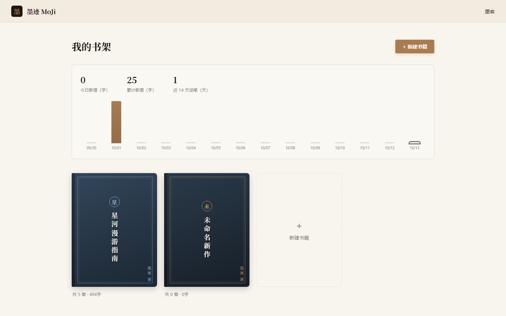
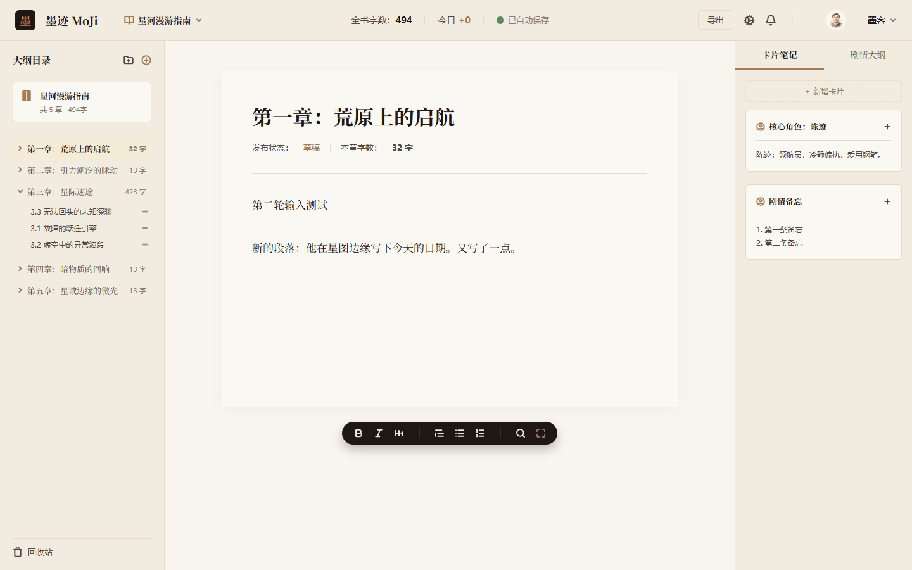
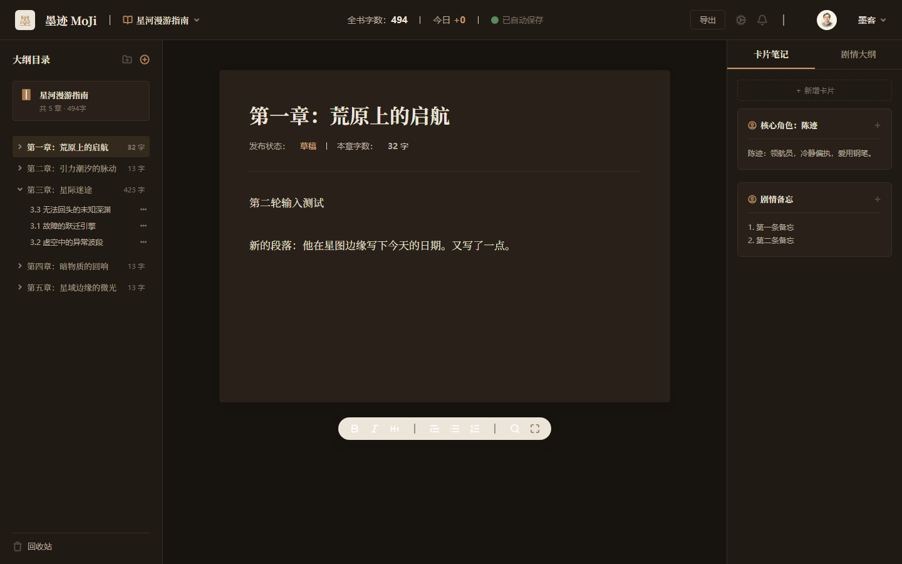

# 墨迹写作 MoJi

> 落笔成墨，行迹皆是星河。

一个**全栈写作应用**，基于 Next.js 15 (App Router) + SQLite 构建。从 Figma 设计稿还原 UI，实现了完整的账号体系、多本书管理、章节编辑与写作统计，并内置可接入任意 OpenAI 兼容服务的 **AI 续写**、**世界观检查**与 **AI 编排长篇生成**。

  

[更新日志](./CHANGELOG.md) · [Roadmap](#roadmap)

## 界面预览

**登录页**


**书架（多本书 + 写作统计）**


**编辑器 · 亮色**


**编辑器 · 暗色模式**


## 功能一览

### 账号体系
- 注册 / 登录（邮箱格式、密码强度前后端双重校验）
- 密码 `scrypt` 哈希存储，会话使用 HMAC 签名的 httpOnly Cookie
- “记住我”：会话有效期 30 天 / 7 天
- `middleware` 路由守卫：未登录访问 `/editor`、`/shelf` 自动跳回登录页

### 书架（`/shelf`）
- 多本书管理：新建、切换书籍，数据按用户隔离
- **书籍删除**：卡片悬停显示删除按钮，确认后软删除（章节内容保留在数据库中），已删除书籍无法通过 URL 直接访问
- **仿真书封面**：中式装帧设计（书脊、双线边框、书名首字印章、竖排书名），6 套墨系配色按书籍 ID 稳定分配
- **写作统计**：今日新增 / 累计新增 / 近 14 天动笔天数 + 纯 CSS 柱状图（零图表依赖，暗色模式自适应）

### 编辑器（`/editor`）
- 稿件直接可编辑（`contentEditable`），无光标跳动
- **自动保存**：停止输入 0.8s 后自动入库，顶栏显示“保存中… → 已自动保存”
- **章节管理**：新建（➕）、双击重命名、拖拽排序（章节与小节各自独立排序，金色指示线）、移入回收站
- **小节折叠/展开**：状态持久化到 localStorage
- **回收站**：软删除 → 恢复 / 彻底删除
- **卡片笔记 / 剧情大纲**：右侧面板双 Tab，每本书独立数据；卡片内容直接可编辑（`contentEditable`，失焦自动保存）、标题双击重命名、支持新增；旧书首次访问自动生成默认卡片（主要角色 / 剧情备忘 / 主线大纲 / 本章要点）
- **AI 续写**：底部工具条「续写」按钮，AI 顺着上文在光标处流式逐字插入（SSE），字数可选 100 / 300 / 500，随时可停；插入走既有自动保存链路。续写时自动注入本书的**卡片笔记与剧情大纲**（世界书），确保人物、世界观与既定情节一致。支持任意 OpenAI 兼容服务（智谱 GLM / DeepSeek / Kimi / MiniMax / OpenAI），见[环境变量](#环境变量可选)
- **世界观检查**：工具条「设定检查」一键对照设定卡与剧情大纲审查本章，弹窗列出每处冲突——等级（矛盾/存疑）、正文原句、冲突来源、原因与修改建议，无冲突时直接给出通过结论
- **AI 编排（计划驱动的长篇生成）**：工具条「AI 编排」用自然语言下达总体计划（如"写 5 大节、每节 10 章，主题……"），总编排者把全书拆成结构化分节计划并持久化到剧情大纲卡片「AI 生成计划」；每次运行生成一个未完成的节——节开始时随机抽 2~3 章旧文建立**节级灵感池**（节内共享），逐章按计划出梗概（标题 + 情节点 + 意外变数方向）并流式成文，设定自检矛盾自动重写一次，完成后写入「AI 生成计划」大纲卡片。弹窗全程可见各阶段进度与实时正文预览，随时可停，**中断后断点续写（精确到章）**；一次跑一节，跑完提示再点继续下一节。大节=顶级章节、章=小节（`1.3 灰烬中的低语`）
- **实时字数**：本章 / 全书 / 今日新增三个维度实时更新
- **Markdown 导出**：本章 / 全书一键下载

### 其他
- 🌙 暗色模式：CSS 变量切换，偏好持久化，防首屏闪烁
- 📱 响应式：< 1024px 隐藏右侧面板，< 768px 隐藏左侧目录

## 技术栈

| 层 | 技术 |
|---|---|
| 框架 | Next.js 15 (App Router)、React 19 |
| 后端 | Next.js API Routes（全栈一体，无需独立后端服务器） |
| 数据库 | SQLite（better-sqlite3），WAL 模式 |
| 认证 | scrypt 密码哈希 + HMAC 签名 Cookie + middleware 守卫 |
| 样式 | 原生 CSS（设计变量驱动，无 UI 框架） |
| UI 来源 | 腾讯云 CodeBuddy 从 Figma 设计稿还原 |

## 快速开始

```bash
# 1. 安装依赖
npm install

# 2. （可选）初始化演示数据：账号 demo@moji.app / moji123456
npm run seed

# 3. 启动开发服务器
npm run dev

# 4. 访问 http://localhost:3000，用演示账号登录即可
```

> 不跑 seed 也可以：直接在 `/register` 注册，首次登录会自动创建一本示例书
> 《星河漫游指南》（含 5 章 3 小节种子数据）。

### Seed 脚本

```bash
npm run seed              # 幂等：用户/书籍已存在则跳过
npm run seed -- --reset   # 危险：清空 .data 后重新初始化
```

支持环境变量覆盖：`SEED_EMAIL`、`SEED_PASSWORD`、`SEED_NAME`。

### 环境变量（可选）

| 变量 | 说明 | 默认值 |
|---|---|---|
| `MOJI_SECRET` | 会话签名密钥 | 开发用默认值，**生产必须设置** |
| `MOJI_AI_KEY` | AI 续写的服务密钥 | 未设置时点「续写」会提示配置 |
| `MOJI_AI_MODEL` | 模型名（如 `glm-4-flash`、`deepseek-chat`） | 同上 |
| `MOJI_AI_BASE` | OpenAI 兼容接口地址 | `https://open.bigmodel.cn/api/paas/v4`（智谱） |

AI 续写配置写入项目根目录 `.env.local`（已被 git 忽略），改完重启 `npm run dev`：

```bash
# 智谱 GLM（有免费模型）
MOJI_AI_BASE=https://open.bigmodel.cn/api/paas/v4
MOJI_AI_KEY=你的key
MOJI_AI_MODEL=glm-4-flash

# 或 DeepSeek
# MOJI_AI_BASE=https://api.deepseek.com
# MOJI_AI_MODEL=deepseek-chat
```

### 生产构建

```bash
npm run build
npm start
```

## 项目结构

```
├── app/
│   ├── page.jsx               # 登录页（/）
│   ├── register/              # 注册页
│   ├── shelf/                 # 书架页（多本书 + 写作统计）
│   ├── editor/                # 编辑器页（核心）
│   ├── api/
│   │   ├── auth/              # login / register / logout / me
│   │   ├── book/              # 书籍 + 章节树（支持 ?bookId=）
│   │   ├── books/             # 书籍列表 / 新建 / 删除（[id]）
│   │   ├── chapters/          # 章节增删改 / 排序 / 恢复
│   │   ├── cards/             # 卡片笔记新增 / 编辑（按书籍隔离）
│   │   ├── ai/                # AI 续写（SSE 流式代理）/ 世界观检查 / AI 编排
│   │   ├── trash/             # 回收站列表
│   │   └── stats/             # 写作统计
│   └── globals.css            # 设计变量（亮/暗两套主题）
├── lib/
│   ├── auth.js                # 用户存储、密码哈希、会话签名
│   ├── db.js                  # SQLite 连接与建表
│   ├── books.js               # 书籍/章节业务逻辑
│   ├── lore.js                # 世界书注入（设定卡 → AI 上下文）
│   └── stats.js               # 每日字数统计
├── middleware.js              # 登录守卫
├── public/assets/             # Figma 导出的图标资源
└── .data/                     # 运行时数据（git 忽略）
```

## 数据模型

```
books(id, user_email, title, created_at, deleted)          -- deleted：书架软删除
chapters(id, book_id, parent_id, title, content, sort_order, deleted, deleted_at, updated_at)
writing_stats(user_email, date, words)                     -- 每日净增减字数
note_cards(id, book_id, tab, title, body, sort_order, updated_at)  -- 卡片笔记（tab: notes/outline）
```

- 章节与书籍删除均为软删除（回收站 / 数据保留），小节通过 `parent_id` 挂载
- 写作统计在章节内容保存时按字数差记录，删字如实扣减
- 旧库升级由 `lib/db.js` 启动时自动执行幂等列迁移（`ALTER TABLE ... ADD COLUMN`）

## Roadmap

- [ ] 部署上线（Vercel + Turso 云数据库，或持久磁盘平台）
- [ ] 书架搜索
- [ ] 回收站按书籍分组
- [ ] 每日字数曲线细化（按小时）
- [ ] 富文本工具条（加粗/斜体等；底部悬浮工具栏目前仅有 AI 续写为功能位）

## 致谢

- UI 设计稿来自 Figma，通过 CodeBuddy 的 Figma 导入功能还原
- 灵感与坚持，来自每一位深夜码字的写作者
